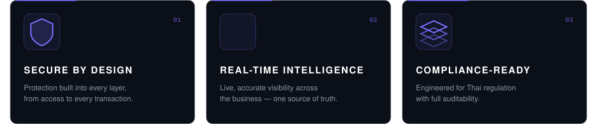
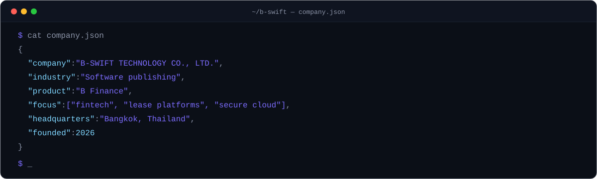

&nbsp; 

  

<b>B-SWIFT TECHNOLOGY</b> builds secure, intelligent software for the future of finance — 
the engineering team behind <a href="https://b-finance.net/"><b>B Finance</b></a>.

  

  

